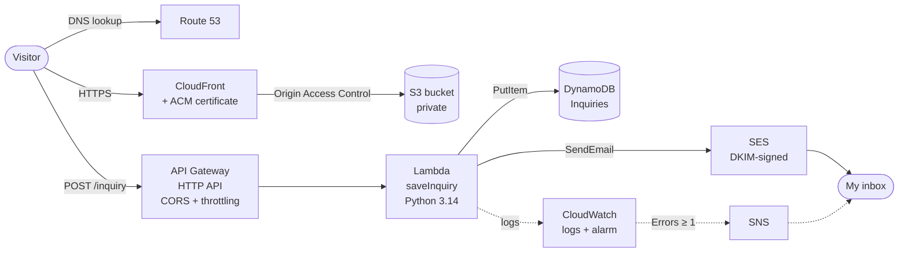

# Serverless Photography Website on AWS

I'm a wedding photographer moving into Cloud/DevOps. This project moves my business website, [www.deokanonga.com](https://www.deokanonga.com), onto AWS and replaces a third-party form service with my own serverless backend: every inquiry a couple sends is validated, saved to a database and emailed to me, with monitoring and alerts if anything fails.

I built every piece by hand in the AWS console, one service at a time, to understand how they fit together.

## Architecture



## Services and why I chose them

| Service | What it does here | Why this and not the alternative |
|---|---|---|
| **S3** | Stores the static site (HTML + photos). The bucket is private. | A static site needs no server to patch or scale. |
| **CloudFront** | CDN: serves the site from edge locations with HTTPS. Reads S3 through **Origin Access Control**. | Faster photo galleries for visitors and no public bucket. |
| **ACM** | Free TLS certificate for the domain (issued in us-east-1 for CloudFront). | Renews automatically. |
| **Route 53** | DNS hosted zone with alias records to CloudFront and email records (MX, SPF, DMARC, DKIM). | Keeps DNS in the same account as everything else. |
| **API Gateway (HTTP API)** | Public endpoint for the form: `POST /inquiry`. CORS allows only my domains; throttling at 5 req/s, burst 10. | Cheaper and simpler than a REST API for one route. |
| **Lambda** | Validates the form, drops bots (honeypot field), saves the inquiry, sends the email. | Runs a fraction of a second per inquiry and costs nothing while idle, unlike an EC2 server. |
| **DynamoDB** | `Inquiries` table, on-demand capacity. Each row gets an ID, timestamp and a `status` field. | Simple records with no joins; serverless like Lambda. |
| **SES** | Sends the notification from my verified domain, with DKIM so it lands in the inbox. Also relays my replies to clients via SMTP. | Pay per email, proper domain authentication. |
| **IAM** | Least-privilege role for the Lambda (see [`iam/`](iam/)). | The function can only write logs, add rows to one table and send email. |
| **CloudWatch + SNS** | Function logs (3-month retention) and an alarm that emails me on any Lambda error. | A failed inquiry is never lost silently. |

## How a form submission flows

1. The browser posts the form to API Gateway (`application/x-www-form-urlencoded`). See [`frontend/inquiry-form.js`](frontend/inquiry-form.js).
2. API Gateway checks CORS and the rate limit, then invokes the Lambda synchronously (payload format 2.0).
3. The Lambda ([`lambda/save_inquiry.py`](lambda/save_inquiry.py)) decodes the body (base64 if needed), keeps only the expected fields, rejects bots and incomplete forms, then:
   - saves the inquiry to DynamoDB **first**, so it is never lost even if email fails,
   - emails it to me with Reply-To set to the couple.
4. It returns `{"success": true}`, and the page shows the thank-you message.

## Security

- Private S3 bucket, readable only by CloudFront (OAC). HTTPS everywhere.
- Root account protected with a passkey (MFA); daily work through a separate role.
- Lambda role scoped to exact actions and resources (no `*` actions).
- **Defense in depth on the form:** CORS → throttling → honeypot → server-side validation.
- Email authentication: SPF, DKIM (3 CNAME keys) and DMARC on the domain.
- A $5 monthly AWS Budget alert.

## Problems I hit and how I fixed them

- **The console's default role had `PowerUserAccess`.** The Lambda creation wizard attached a far broader policy than needed. I replaced it with an inline least-privilege policy and removed the managed one.
- **`AccessDeniedException` on `PutItem`.** The error showed `table/Inquiry`. It was a typo in the `TABLE_NAME` environment variable, and the least-privilege policy (scoped to `table/Inquiries`) caught it.
- **`AccessDenied` on `ses:SendEmail` for a configuration set.** The SES setup wizard attached a default configuration set to the domain, and SES authorizes the configuration set as well as the identity. I added its ARN to the policy.
- **Domain transfer blocked.** ICANN's 60-day lock on newly registered domains blocks the move from Cloudflare to Route 53. The AWS stack is live and tested on the CloudFront URL; DNS cuts over when the lock ends.
- **Paid "SMTP" wizard.** The new SES SMTP setup creates a Mail Manager ingress endpoint (about $50/month). I used classic IAM SMTP credentials instead.

## Testing

- Console test events for the Lambda: a valid inquiry, a base64-encoded body, and a deliberately broken body to prove the CloudWatch alarm emails me.
- End-to-end test through the real form on the CloudFront URL.

## Cost

About **$0.50–$1.50 a month**, mostly the Route 53 hosted zone. Lambda, DynamoDB, CloudFront and API Gateway stay within free tiers at this volume.

## What's next

- **Project 2:** a private admin dashboard (Cognito login, JWT-protected API routes) to track each client from "new" to "delivered".
- Infrastructure as code (AWS SAM or Terraform) so the whole stack can be rebuilt with one command.
- A CI/CD pipeline (GitHub Actions) that deploys site changes to S3 and invalidates CloudFront.

## Repository structure

```
lambda/save_inquiry.py      the Lambda function (Python)
iam/save-inquiry-policy.json  least-privilege execution policy
frontend/inquiry-form.js    the browser code that calls the API
```

Account IDs and API IDs are replaced with placeholders like `<ACCOUNT_ID>`.
